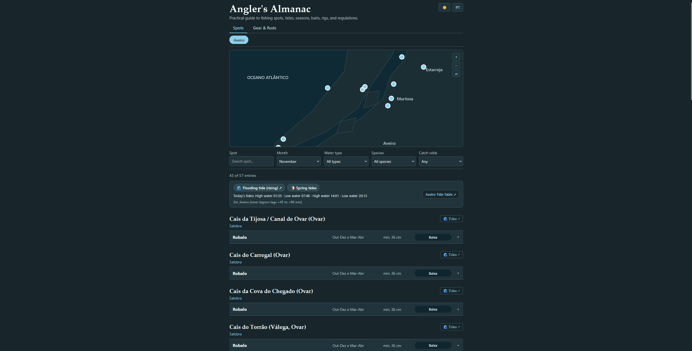

  
# Angler's Almanac

<i>Angler's Almanac: practical fishing guide with top spots, tides, seasons, rigs, knots, checklist, and recreational fishing rules in Portugal.</i>

<kbd>  </kbd>

 

## Table of Contents

- [Features](#features)
- [How to Use](#how-to-use)
- [Performance Score](#pagespeed-insights-performance-score)
- [Contributing](#contributing)
- [License](#license)

 

## Features

- **Spot Finder & Interactive Map**: Filter fishing spots by district, water type (channel, pier, beach), species, bait, and tide phase, with synchronized pins on an interactive Leaflet map.
- **Species, Seasons, Sizes & Catch Odds**: Inside the **Spots** tab, check target species, best time of the year, minimum legal sizes, and catch probability for each location.
- **Live Tide & Moon Bar**: Automatically calculates the current lunar phase, tide state (rising, falling, slack), and estimated high/low tide windows with direct links to local tide charts.
- **Equipment, Lures & Rigs Reference**: Browse curated guides for rods, rigs, lures, and knots (with difficulty/technique filters and inline cross-reference tooltips across the app).
- **Pre-Trip Interactive Checklist**: Filter essential gear by fishing technique (_Spinning_, _Float_, _Bottom_, _Eging_) with persistent progress saved automatically in the browser.
- **Bilingual & Theme Support**: Instant switching between Portuguese (`PT`) and English (`EN`), plus Light and Dark modes adapted for day and night sessions.

 

## How to Use

1. **Choose Your District & Filters**: Select a district at the top of the **Spots** tab and filter locations by target species, water type, bait, or tide state.
2. **Explore Spots, Species & Tide Windows**: Click any spot card (or map pin) to check access notes, target species, best time of the year, minimum legal sizes, catch probability, and local tide charts.
3. **Preview Lures & Rigs Inline**: Hover or tap on highlighted lures and rigs inside the spot descriptions to see quick visual and technical tooltips.
4. **Review Rigs, Knots & Lures**: Switch to the **Equipment** tab to compare rods, terminal tackle setups, lures, and step-by-step knot tutorials filtered by technique.
5. **Pack with the Checklist**: Go to **Equipment → Checklist**, select your planned fishing technique, and check off your gear as you pack, your progress is saved automatically.

 

## PageSpeed Insights Performance Score

  
| [Desktop](https://pagespeed.web.dev/analysis/https-eduardasrbastos-github-io-angler-almanac/zacmq8kevy?form_factor=desktop) | [Mobile](https://pagespeed.web.dev/analysis/https-eduardasrbastos-github-io-angler-almanac/zacmq8kevy?form_factor=mobile) |
|-------|-------|
| <kbd>  </kbd> | <kbd>  </kbd> |

## Contributing

- Support this project by giving it a star ⭐. Thanks!
- Feel free to suggest improvements or report any issues in the repository.

## License

This project is licensed under the MIT License - see the [LICENSE](LICENSE) file for details.
